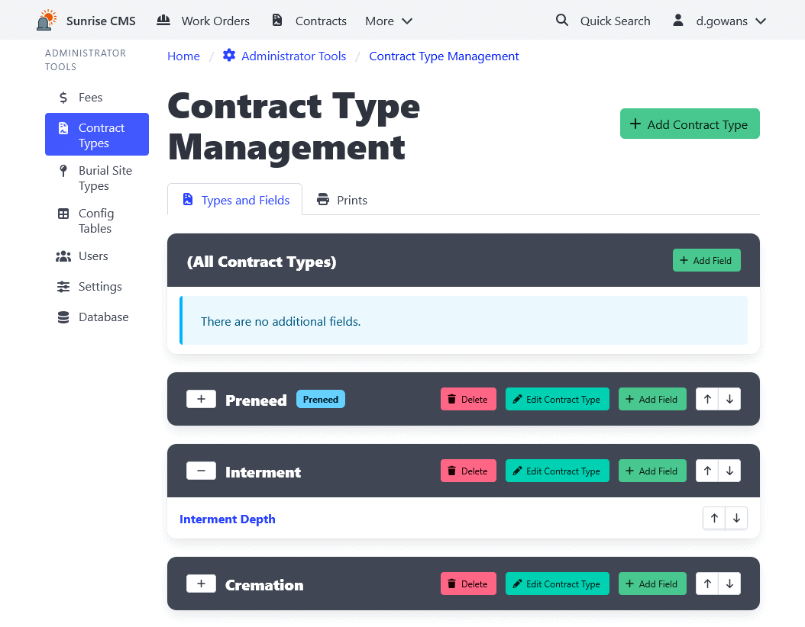

[Home](https://cityssm.github.io/sunrise-cms/)
•
[Help](https://cityssm.github.io/sunrise-cms/docs/)

# Contract Type Management

Contract types describe the kinds of agreements managed by Sunrise CMS, such
as preneed contracts or interment contracts.

## Types and Fields

Use **Add Contract Type** to create a type. A contract type can be:

- Marked as a preneed contract type.
- Made available to an enabled external portal integration.
- Given one or more custom fields.

Expand a contract type to manage its custom fields. Custom fields appear on
contracts of that type and can be reordered or removed. Use the edit controls
for a contract type to change its name or settings.

The arrows beside a contract type change the order in which types are offered
throughout Sunrise CMS.

## Prints

The **Prints** tab controls which print layouts are available for each contract
type. Add a layout to make it available when viewing or printing that type of
contract. Layouts can be reordered or removed.

Available layouts include the built-in screen and PDF prints configured in the
application.

## Related

- [Fee Management](feeManagement.md)
- [Contracts](contracts.md)
