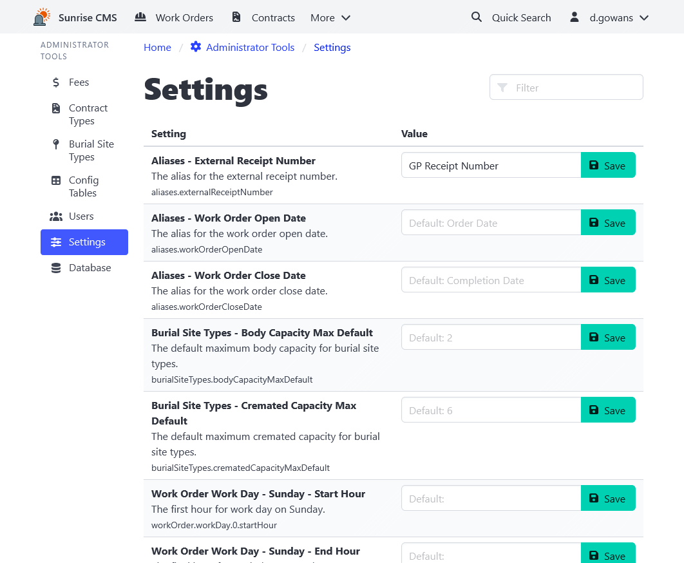

[Home](https://cityssm.github.io/sunrise-cms/)
•
[Help](https://cityssm.github.io/sunrise-cms/docs/)

# Settings

Some of the settings that are more commonly maintained by application power users
can be set in the Sunrise CMS interface. Settings updated here take effect immediately.

💡 Settings that change less frequently are found in the [`config.js` file](configJs.md).

## Using the Settings Page

Use the filter field to find a setting by name, key, or description. Each
setting shows:

- Its display name and description.
- Its configuration key.
- The default value.
- The value currently saved in the database.

For text settings, enter the desired value and select **Save**. For boolean
settings, choose **True**, **False**, or **Default** and save the selection.

Settings marked as not user-configurable are only available in `config.js`.
